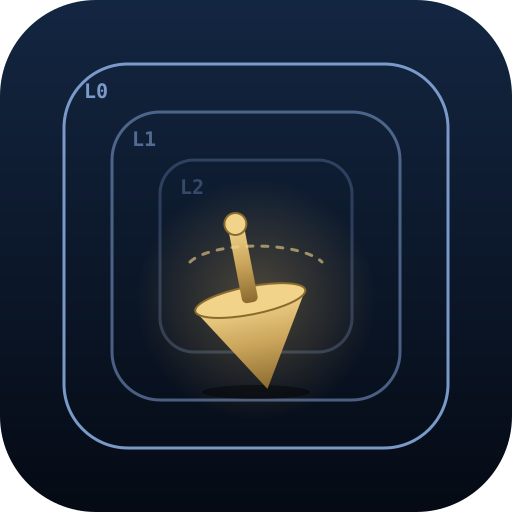

<p align="center">
  
</p>

<h1 align="center">inception</h1>

<p align="center">
  <em>One job, several levels. You are The Architect.</em>
</p>

<p align="center">
  
  
  
</p>

---

A [Claude Code](https://claude.com/claude-code) plugin that turns one session
into a **layered multi-agent orchestrator**. You stay topside as the Architect.
The work goes one level down to the right model, runs in parallel, and nothing
comes back up until your own totem has fallen.

Born from a real session that shipped in one sitting: a whole-repo
over-engineering audit (−5,600 lines, −23 dependencies), a production security
fix, two game features, a test suite for the most fragile hook, 31 lint-warning
judgment calls, and a full cosmetics economy — by running the right work on the
right level, at the same time, with independent verification before every
commit.

## The idea in one picture

```
   TOPSIDE ──────────────────────────────────────────────────────
        ┌──────────────────────────────────────┐
        │  L0 · THE ARCHITECT  · top-tier model │  designs the levels
        │  your main session                    │  spins the totem · kicks
        └───────────────────┬──────────────────┘  owns every risky call
                            │  fenced briefs, dealt in parallel
   LEVEL 1 ─────────────────┼────────────────────────────────────
              ┌─────────────┴─────────────┐
              ▼                           │
   ┌────────────────────┐                 │
   │  L1 · THE FORGER   │                 │   each level runs in its
   │  strong model      │                 │   own herdr pane — a dream
   │  decides whether   │                 │   you can watch
   │  as well as how    │                 ▼
   └────────────────────┘      ┌────────────────────┐
   LEVEL 2 ────────────────────│  L2 · THE POINT MAN│────────────
                               │  fast model        │
                               │  outcome pinned,   │
                               │  executes exactly  │
                               └────────────────────┘
```

## The levels

The levels *are* model tiers. You place work on a level by asking one
question: **how much does the prompt have to decide?**

| Level | Who runs it | What it gets | The test |
|-------|-------------|--------------|----------|
| **L0 · The Architect** | You — the top model in the session | Planning, prioritization, integration, final verification, anything security- or money-adjacent | *Decides **what the goal is***. Never delegated. |
| **L1 · The Forger** (`l1-forger`) | A strong model (e.g. Opus) | Refactors needing taste, test suites for gnarly code, case-by-case fixes (each lint warning judged on its merits) | *Decides **whether** as well as **how***. |
| **L2 · The Point Man** (`l2-point-man`) | A fast model (e.g. Sonnet) | Migrations, renames, dedups, mechanical wiring — anything you can fully specify up front | *Only decides **how**; the outcome is already pinned.* |

> If a prompt can fully specify the outcome, it is Level 2 work — hand it to
> the fast model. If the agent must exercise judgment, it is Level 1 work —
> spend the strong model. If it has to decide the objective itself, it stays
> at Level 0. That's you.

Spending Opus on a mechanical rename is as wrong as handing a judgment refactor
to a fast model. Level matching is the whole game. The level number is baked
into every agent name and every report tag (`[L1 forger]`, `[L2 point-man]`),
so you always see who is where.

## The vocabulary

The film's mechanics map onto orchestration almost one to one, so the plugin
uses them as the working words:

| Word | Means |
|------|-------|
| **Level** | One executor, one model, one fenced scope. L0 is you. |
| **Time dilation** | Parallelism. Several levels running at once means far more happens per topside minute. |
| **Fence** | The files a level may not touch. Keeps the projections calm. |
| **Projections** | Scope collisions. Two levels writing the same file is the subconscious turning hostile. |
| **Limbo** | A level that went silent without reporting. Nobody gets left there. |
| **Totem** | Your own verification run. An agent's green is a dream until your totem falls. |
| **Kick** | The commit that brings verified work topside. One kick per level. |

## How orchestration works

The Architect runs a five-step loop. Scale the depth to the job — a one-file
fix needs zero levels; only a genuine multi-front session earns the full
descent.

1. **Scope with an audit, not a guess.** Before delegating anything, produce a
   *ranked findings list* yourself — read the tree, measure, count usages. Rank
   by value-per-effort, biggest cut first. Pure deletions rank above refactors:
   they're CI-verifiable and carry zero design risk. Trivial items you do inline;
   only real work earns a level. (`/architect` does exactly this phase.)

2. **Build the levels with fenced scopes.** Deal independent agents *in one
   move* so they run at once. Every brief carries five things — see
   [the fenced brief](docs/orchestration.md#the-fenced-brief). The iron rule:
   **no two concurrent levels may write the same file.** Every brief names the
   files it must *not* touch and which level owns them instead.

3. **Keep every level out of limbo.** An agent goes quiet without a report →
   message it and demand one; silence is not success. A spawn fails → retry
   once, then do it inline rather than block. An agent blames a failure on
   "someone else" → check whether *you* caused it with a concurrent edit.
   (`/totem`.)

4. **Spin the totem, then kick.** An agent's "all green" is a *claim*. Re-run
   the full typecheck + test suite yourself before committing its work as its
   own commit, with a message saying what changed *and why*.

5. **Wake up clean.** Restate the findings that matter to the user (they never
   saw what happened a level down). Log the session before context runs out.
   Fix stale docs the moment you notice they lie. (`/kick` harvests the
   lessons.)

The full field guide — the brief template, the verification protocol, the
spec→plan→execute gate for features, and the pitfalls list — lives in
[docs/orchestration.md](docs/orchestration.md).

## herdr: the dream levels

There are two ways to go down, and the herdr one is what makes this a
*framework* you can watch instead of a black box.

**In-session sub-agents.** Ask the Architect to orchestrate and it spawns
headless sub-agents that run concurrently and report back. Zero setup, right
for most tasks. You see summaries, not keystrokes.

**herdr dream levels.** When you want to *watch* the levels work — and,
critically, pin a different model to each — give every level its own pane
running a separate Claude process. herdr is an agent multiplexer built for
exactly this: named agents, per-pane state, `agent wait` on completion. The
model binding is one flag: `claude --model`. Name the panes by level so the
UI shows you who is where.

```bash
# The Architect stays in your live herdr pane and writes each level a fenced
# brief (see docs/orchestration.md) into .inception/. Then deal the levels —
# each spawns as a named agent split off your pane, model bound via --model:

herdr agent start l1-forger    --split right -- claude --model opus   "$(cat .inception/l1-forger.md)"
herdr agent start l2-point-man --split down  -- claude --model sonnet "$(cat .inception/l2-point-man.md)"

# No attach step — they appear in your UI. Watch, then collect:
herdr agent read l2-point-man --source recent --lines 40   # peek at a level
herdr agent wait l2-point-man --status idle                # block until it surfaces
```

Now the metaphor is literal: three panes, three levels, three jobs running side
by side with the level number in every pane name. You keep your pane (L0) to
integrate and verify; the levels work in theirs. Use interactive `claude "…"`
when you want to interject mid-dream, or `claude -p "…"` for fire-and-forget
headless runs whose output you collect at the end. Either way, **the fences in
each brief are what keep two panes from writing the same file** — that
discipline matters more here than anywhere, because now the projections are
real processes, not one model's sequential edits.

## Install

```
/plugin marketplace add XyndoX/inception
/plugin install inception@inception
```

…or from a local clone:

```bash
claude plugin install /path/to/inception
```

Then just ask Claude to "orchestrate" / "go deeper" on a big multi-part task,
or:

```
/inception tackle the ranked findings from this audit
```

## Commands

| Command | What it does |
|---------|--------------|
| `/inception <task>` | Run the full orchestration loop on a large, multi-part task. |
| `/architect` | The scope-and-rank phase only — a ranked findings list with a level per item, no delegation, no edits. |
| `/totem` | Spin the totem on the running levels: who's idle, who's in limbo, whose work is unverified, who's colliding. |
| `/kick` | Post-session retrospective — bring the session's scars topside as durable doctrine (a rule, a pitfall, a fence) instead of a summary nobody rereads. |

## What's inside

- **`skills/inception/SKILL.md`** — the workflow the Architect runs: the level
  ladder, the fan-out loop, limbo handling, external-system discipline, the
  spec→plan→execute gate, and a field-tested pitfall list.
- **`commands/`** — the four slash commands above.
- **`agents/`** — `l1-forger` (strong model) and `l2-point-man` (fast model)
  as typed, spawnable levels with the model pre-bound, the level number in the
  name, and the iron rules (fences, disposable fixtures, paid-API caution,
  honest reports, never idle in silence) baked into their definitions — level
  matching enforced by structure, not memory.
- **`docs/orchestration.md`** — the operational playbook: the fenced-brief
  template, the herdr recipes, the verification protocol.
- **`AGENTS.md`** — the condensed workflow for non-Claude harnesses.

## Pairs well with

- [superpowers](https://github.com/obra/superpowers) — the
  brainstorm→spec→plan→execute pipeline the Architect uses for feature work.
- A minimalism skill like **ponytail** — inception decides *who* does the
  work; a minimalism skill decides *how much* work there should be. Run the
  audit through both and you cut the right things with the right hands.

## FAQ

**Do I have to use herdr?**
No. In-session sub-agents need zero setup and cover most work. herdr is for when
you want to watch the levels live and pin a distinct model to each pane.

**Isn't spawning agents just overhead?**
Yes — overhead you must earn back in time dilation. One workstream? Do it
inline. The loop only pays off when independent work can genuinely run at the
same time.

**Can I go deeper than Level 2?**
The plugin ships two working levels because two model tiers below yours is
what pays for itself. If a Forger needs to fan out its own Point Men, that is
a level within a level — same rules, same fences, and its reports still have
to surface through L1 before your totem spins.

**Why the Inception names?**
The Architect draws the levels and never goes under. The Forger becomes
whatever the job needs. The Point Man runs the logistics exactly. The totem is
the only thing that tells you what's real. Same film, same division of labor.

## License

[MIT](LICENSE).
